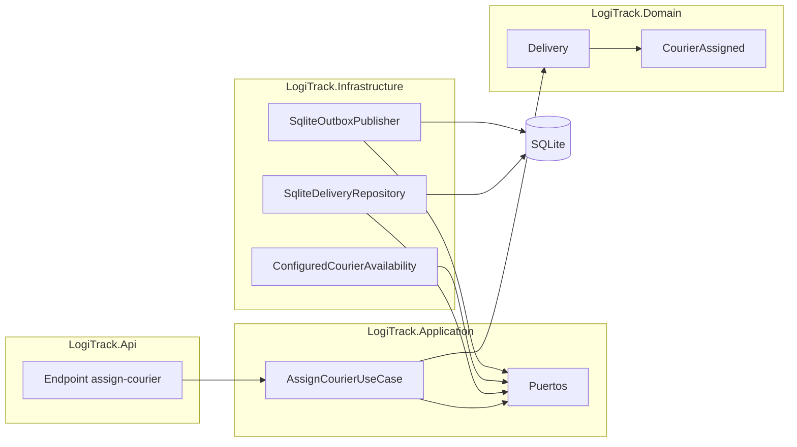

# Arquitectura de LogiTrack

## Estado de la propuesta

LogiTrack se implementa como un **monolito modular** según [ADR-001](docs/actividad-2/05-adr-001-decision-estructural.md). La Actividad 3 diseñó el flujo de asignación y la Actividad 4 lo materializó como un vertical slice en .NET 9 con persistencia SQLite.

## Capas y dirección de dependencias

```text
Adaptadores de entrada -> Aplicación -> Dominio
Adaptadores de salida  -> Puertos de Aplicación/Dominio
```

- **Dominio:** entidades, objetos de valor, eventos e invariantes; no conoce infraestructura.
- **Aplicación:** casos de uso, comandos, resultados y puertos; orquesta el dominio.
- **Infraestructura:** repositorios, API, publicación, reloj y adaptadores de entrada.

Las capas internas no dependen de detalles externos. Los casos de uso reciben sus dependencias mediante interfaces y los adaptadores implementan esas interfaces.

## Módulos

| Módulo | Propiedad principal |
| --- | --- |
| Gestión de pedidos | Pedidos, origen y consulta central. |
| Inventario | Validación de inventario. |
| Asignaciones y entregas | Entregas, asignaciones, estados y eventos. |
| Incidencias | Incidencias y su tratamiento. |
| Acceso | Identidades y políticas. |
| Integraciones externas | Traducción y aislamiento de sistemas externos. |

La colaboración ocurre mediante contratos. Se prohíben escrituras directas en información de otro módulo y dependencias cíclicas.

## Rebanada de diseño: asignar repartidor

`AssignCourierUseCase` carga una Entrega, verifica autorización, disponibilidad y capacidad mediante puertos, ejecuta `Delivery.AssignCourier`, persiste por `IDeliveryRepository` y entrega `CourierAssigned` a un publicador. `Delivery` protege que solo exista un repartidor activo.

## Documentación detallada

1. [Flujo y lenguaje ubicuo](docs/actividad-3/01-flujo-y-lenguaje-ubicuo.md)
2. [Modelo de dominio](docs/actividad-3/02-modelo-de-dominio.md)
3. [Escenarios de aceptación](docs/actividad-3/03-escenarios-de-aceptacion.md)
4. [Contextos, capas, puertos y adaptadores](docs/actividad-3/04-contextos-puertos-y-adaptadores.md)
5. [Casos de uso y contratos](docs/actividad-3/05-casos-de-uso-y-contratos.md)
6. [C4 actualizado](docs/actividad-3/06-diagrama-c4.md)
7. [ADR-002](docs/actividad-3/adr/ADR-002-modelo-asignacion-repartidor.md)

## Decisiones vigentes

- ADR-001: monolito modular.
- ADR-002: Entrega como agregado y arquitectura de puertos y adaptadores para la asignación.

## Restricciones y pendientes

Los estados, responsables, permisos, fuente real de disponibilidad, capacidad de ruta, reasignación y contratos externos deben validarse. La implementación actual es una rebanada académica y no se presenta como despliegue productivo.

## Implementación de la Actividad 4



### Decisiones de implementación

- SQLite con migración SQL versionada y ejecutor propio.
- Concurrencia optimista mediante versión esperada.
- Outbox transaccional para no perder `CourierAssigned`.
- API key obtenida por configuración y autorización por rol como límite académico.
- Logs estructurados, correlación, `Meter` y `ActivitySource`.
- Pruebas separadas de dominio, aplicación, integración y arquitectura.

### Evidencia automatizada

- 5 pruebas de dominio;
- 7 pruebas de aplicación;
- 7 pruebas de integración;
- 2 pruebas arquitectónicas;
- compilación con advertencias tratadas como errores;
- formato y CI verificables.

### Documentos relacionados

- [Alcance y trazabilidad](docs/actividad-4/01-alcance-y-trazabilidad.md)
- [Pruebas y evidencia](docs/actividad-4/04-pruebas-y-evidencia.md)
- [Riesgos y observabilidad](docs/actividad-4/05-riesgos-seguridad-y-observabilidad.md)
- [ADR-003](docs/actividad-4/adr/ADR-003-decisiones-de-implementacion.md)

