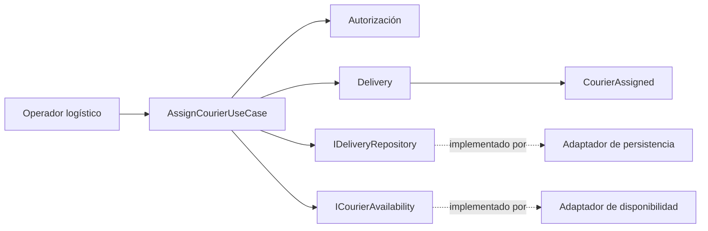
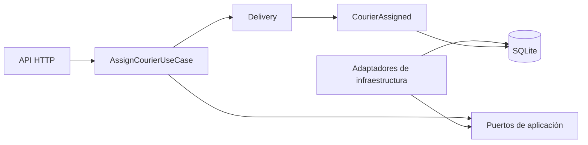

# LogiTrack

## Resumen ejecutivo

LogiTrack es una propuesta de producto para apoyar la gestión logística de última milla de una empresa de retail digital. La empresa recibe pedidos desde varios canales, administra inventarios distribuidos y coordina entregas mediante diferentes rutas y repartidores.

En la situación actual no existe una vista centralizada del estado de los pedidos. Esta falta de integración genera duplicación de información, retrasos, errores operativos y poca trazabilidad durante el proceso logístico.

Los usuarios principales contemplados son el personal encargado de la operación logística y los repartidores que participan en las entregas. Sus necesidades se relacionan con la consulta y actualización oportuna de la información necesaria para coordinar los pedidos y conocer su estado.

El objetivo general de LogiTrack es ofrecer una plataforma centralizada que permita registrar pedidos, validar inventario, asignar rutas, rastrear entregas y gestionar incidencias. Esta formulación representa el alcance funcional inicial del producto y no constituye una selección de arquitectura técnica ni de tecnologías.

El proyecto se ha documentado de manera progresiva. La Actividad 1 desarrolló el diagnóstico y el contexto arquitectónico; la Actividad 2 definió requisitos y la decisión estructural; la Actividad 3 diseñó el dominio; y la Actividad 4 implementó y validó el vertical slice de asignación de repartidor con .NET 9 y SQLite.

## Actividad 1: Diagnóstico y contexto arquitectónico

Esta actividad analiza el problema actual, identifica los actores y sistemas externos, delimita el alcance y presenta las decisiones y los riesgos iniciales. Los seis documentos principales están disponibles en el repositorio:

1. [Análisis del problema](docs/actividad-1/01-analisis-del-problema.md): explica la situación actual, el problema central, sus consecuencias y las variables relevantes.
2. [Actores](docs/actividad-1/02-actores.md): identifica los actores humanos, los sistemas externos y sus posibles interacciones con LogiTrack.
3. [Alcance y supuestos](docs/actividad-1/03-alcance-y-supuestos.md): delimita las capacidades contempladas, las exclusiones propuestas y la información pendiente de validar.
4. [Diagrama de contexto](docs/actividad-1/04-diagrama-de-contexto.md): representa el límite de LogiTrack, los actores, los sistemas externos y los principales intercambios de información.
5. [Registro de decisiones iniciales](docs/actividad-1/05-registro-de-decisiones.md): documenta las decisiones de alcance y la propuesta funcional de una plataforma centralizada.
6. [Registro de riesgos](docs/actividad-1/06-registro-de-riesgos.md): identifica los problemas actuales y los riesgos potenciales relacionados con la propuesta.

### Video de sustentación de la Actividad 1

**Estado:** pendiente de agregar un enlace confirmado.

## Actividad 2: Requisitos y decisión estructural

Esta actividad convierte el diagnóstico anterior en requisitos verificables y utiliza los atributos de calidad para orientar una decisión estructural inicial.

### Requisitos y prioridades

El catálogo contiene **11 requisitos funcionales (RF-001 a RF-011)** y **8 atributos de calidad (AC-001 a AC-008)**. Los requisitos funcionales abarcan el registro y la consulta de pedidos, la validación de inventario, las asignaciones y entregas, las incidencias, el acceso por actor y los posibles intercambios con sistemas externos.

Los requisitos funcionales de prioridad alta son:

- RF-001 — Registro de pedidos de distintos canales.
- RF-002 — Consulta centralizada del pedido.
- RF-003 — Validación de inventario distribuido.
- RF-004 — Asignación de ruta y repartidor.
- RF-005 — Seguimiento del estado de la entrega.
- RF-007 — Acceso según el actor.

Los atributos de calidad de prioridad alta son:

- AC-001 — Consistencia e integridad de la información.
- AC-002 — Trazabilidad.
- AC-003 — Vigencia de la información.
- AC-004 — Interoperabilidad.
- AC-005 — Control de acceso.
- AC-007 — Resiliencia ante intercambios externos.

Estas prioridades son propuestas académicas y deberán revisarse cuando se disponga de información real de la operación.

### Escenarios de calidad

Se definieron ocho escenarios medibles, EC-001 a EC-008, que cubren consistencia, trazabilidad, vigencia, interoperabilidad, control de acceso, resiliencia, escalabilidad y rendimiento. EC-001 a EC-006 tienen prioridad alta, mientras que EC-007 y EC-008 tienen prioridad media.

Sus métricas y umbrales son **objetivos académicos propuestos y pendientes de validación**. Todavía no representan resultados de pruebas ni compromisos reales de la empresa.

### Alternativas y decisión estructural

Se compararon dos alternativas:

- **Monolito modular:** una aplicación desplegable como unidad, organizada internamente en módulos con responsabilidades y límites claros.
- **Arquitectura distribuida por servicios:** servicios separados por capacidades o dominios, con comunicación y despliegue independiente.

El ADR-001 establece que LogiTrack comenzará con un **monolito modular**, aceptado para el diseño académico inicial y sujeto a revisión si cambian los supuestos. La decisión busca facilitar la coordinación de la información central del pedido y evitar una complejidad distribuida que todavía no está justificada por datos operativos.

La alternativa elegida no garantiza por sí sola la consistencia, la seguridad, la trazabilidad ni el rendimiento. Sus principales limitaciones son el despliegue conjunto, el escalado menos granular, el uso compartido de recursos y un mayor radio de impacto ante determinadas fallas. Por esta razón, el ADR exige responsabilidades claras, contratos internos y dependencias controladas entre módulos.

### Criterios verificables

Se definieron 17 criterios, CV-001 a CV-017, para evaluar la cobertura de requisitos y atributos, los escenarios de calidad, los límites modulares, las dependencias, los contratos internos, el control de acceso, la trazabilidad, las integraciones, la coherencia con el alcance y la documentación de decisiones y riesgos.

Los criterios diferencian la revisión documental que puede realizarse durante el diseño, las pruebas que requieren una implementación y la validación que depende de información real del negocio. La existencia de los documentos no demuestra por sí sola que los criterios ya se cumplen.

### Documentación de la Actividad 2

1. [Catálogo de requisitos](docs/actividad-2/01-catalogo-de-requisitos.md)
2. [Matriz de priorización](docs/actividad-2/02-matriz-de-priorizacion.md)
3. [Escenarios de calidad](docs/actividad-2/03-escenarios-de-calidad.md)
4. [Comparación de alternativas estructurales](docs/actividad-2/04-comparacion-de-alternativas-estructurales.md)
5. [ADR-001 — Decisión estructural inicial](docs/actividad-2/05-adr-001-decision-estructural.md)
6. [Criterios verificables de evaluación](docs/actividad-2/06-criterios-verificables-de-evaluacion.md)

### Video de sustentación de la Actividad 2

**Estado:** pendiente de agregar un enlace confirmado.

## Actividad 3: Diseño y dominio

La Actividad 3 modela el flujo **asignar un repartidor a una entrega existente** mediante `AssignCourierUseCase`. La propuesta conserva el monolito modular de ADR-001, ubica las invariantes en la entidad `Delivery` y separa Dominio, Aplicación e Infraestructura mediante puertos y adaptadores.

No se implementan todavía la persistencia ni una integración externa real. Los permisos, estados, reglas de disponibilidad y capacidad se mantienen como propuestas pendientes de validación.

### Vista resumida del flujo



El caso de uso coordina la operación; `Delivery` protege que la entrega no tenga más de un repartidor activo; y la infraestructura implementa los puertos sin introducir sus detalles en el dominio.

1. [Flujo y lenguaje ubicuo](docs/actividad-3/01-flujo-y-lenguaje-ubicuo.md)
2. [Modelo de dominio](docs/actividad-3/02-modelo-de-dominio.md)
3. [Escenarios de aceptación](docs/actividad-3/03-escenarios-de-aceptacion.md)
4. [Contextos, capas, puertos y adaptadores](docs/actividad-3/04-contextos-puertos-y-adaptadores.md)
5. [Casos de uso y contratos](docs/actividad-3/05-casos-de-uso-y-contratos.md)
6. [Diagramas C4](docs/actividad-3/06-diagrama-c4.md)
7. [Trazabilidad y checklist](docs/actividad-3/07-trazabilidad-y-checklist.md)
8. [ADR-002](docs/actividad-3/adr/ADR-002-modelo-asignacion-repartidor.md)
9. [Architecture.md](Architecture.md)

### Video de sustentación de la Actividad 3

**Estado:** pendiente de agregar un enlace confirmado.

## Actividad 4: Construcción, validación y defensa final

La Actividad 4 implementa `AssignCourierUseCase` como un vertical slice ejecutable. La entrada HTTP conecta Aplicación, el agregado `Delivery`, SQLite, disponibilidad configurable y publicación mediante outbox sin invertir las dependencias definidas en la Actividad 3.



### Ejecución rápida

Requisitos: .NET SDK 9.0.200.

```powershell
dotnet restore LogiTrack.sln
$env:Security__ApiKey = "una-clave-local-no-compartida"
dotnet run --project src/LogiTrack.Api/LogiTrack.Api.csproj --urls http://127.0.0.1:5055
```

La migración se aplica automáticamente. En Development se crea la entrega demo `11111111-1111-1111-1111-111111111111`. Las solicitudes de ejemplo están en `src/LogiTrack.Api/LogiTrack.Api.http`.

### Verificación

```powershell
powershell -ExecutionPolicy Bypass -File scripts/verify.ps1
```

La verificación ejecuta compilación, 21 pruebas automatizadas y control de formato. Las pruebas cubren dominio, aplicación, integración HTTP–SQLite y dependencias arquitectónicas.

### Documentación

1. [Alcance y trazabilidad](docs/actividad-4/01-alcance-y-trazabilidad.md)
2. [Implementación y ejecución](docs/actividad-4/02-implementacion-y-ejecucion.md)
3. [Persistencia e integraciones](docs/actividad-4/03-persistencia-e-integraciones.md)
4. [Pruebas y evidencia](docs/actividad-4/04-pruebas-y-evidencia.md)
5. [Riesgos, seguridad y observabilidad](docs/actividad-4/05-riesgos-seguridad-y-observabilidad.md)
6. [Resultados y próximos pasos](docs/actividad-4/06-resultados-y-proximos-pasos.md)
7. [Checklist final](docs/actividad-4/07-checklist-final.md)
8. [ADR-003](docs/actividad-4/adr/ADR-003-decisiones-de-implementacion.md)
9. [Arquitectura consolidada](Architecture.md)

### Video de demostración y defensa final

**Estado:** pendiente de agregar un enlace confirmado.
