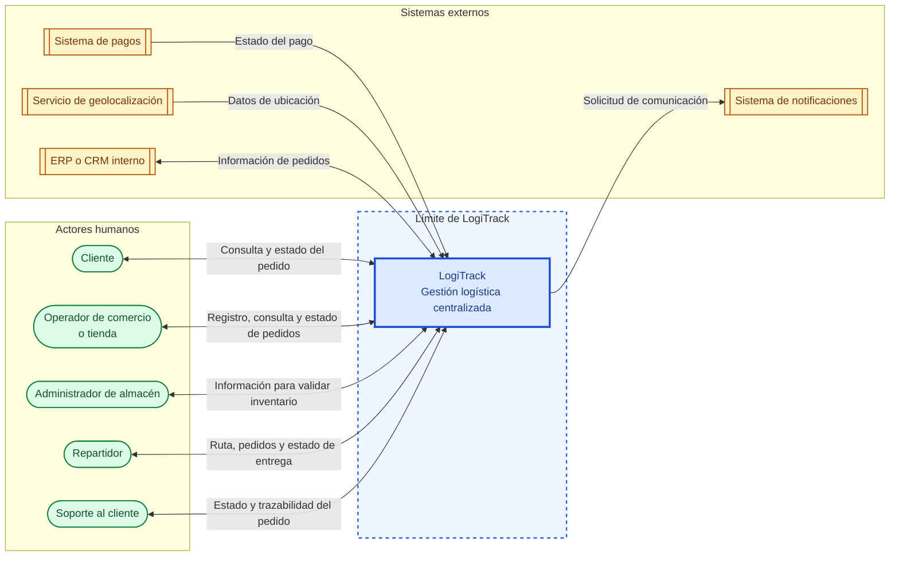

# Diagrama de contexto

## Introducción

Este diagrama presenta a LogiTrack como el sistema central y muestra los actores humanos y los sistemas externos que forman parte de su contexto. Su propósito es representar los límites y los principales intercambios de información, sin describir componentes internos ni establecer una arquitectura técnica.

## Diagrama

## Relaciones representadas

Los actores humanos se relacionan con LogiTrack de acuerdo con su participación en la gestión del pedido. El cliente consulta su estado; el operador de comercio o tienda registra o consulta pedidos; el administrador de almacén interviene en la validación de inventario; el repartidor consulta sus asignaciones e informa el estado de la entrega; y soporte al cliente consulta el estado y la trazabilidad para atender solicitudes.

Los sistemas externos aparecen fuera del límite de LogiTrack. El sistema de pagos aporta el estado del pago, el servicio de geolocalización suministra datos de ubicación, el sistema de notificaciones recibe solicitudes de comunicación y el ERP o CRM interno intercambia información relacionada con los pedidos. En el diagrama, el verde identifica actores humanos, el amarillo identifica sistemas externos y el azul identifica LogiTrack.

## Interacciones pendientes de validación

Las relaciones del diagrama son propuestas iniciales construidas a partir del caso y de los documentos anteriores. No representan integraciones confirmadas. Aún deben validarse los datos exactos, el sentido de cada intercambio, los responsables de actualizar la información y los mecanismos de comunicación. El diagrama tampoco define la estructura interna de LogiTrack ni implica una elección tecnológica.
