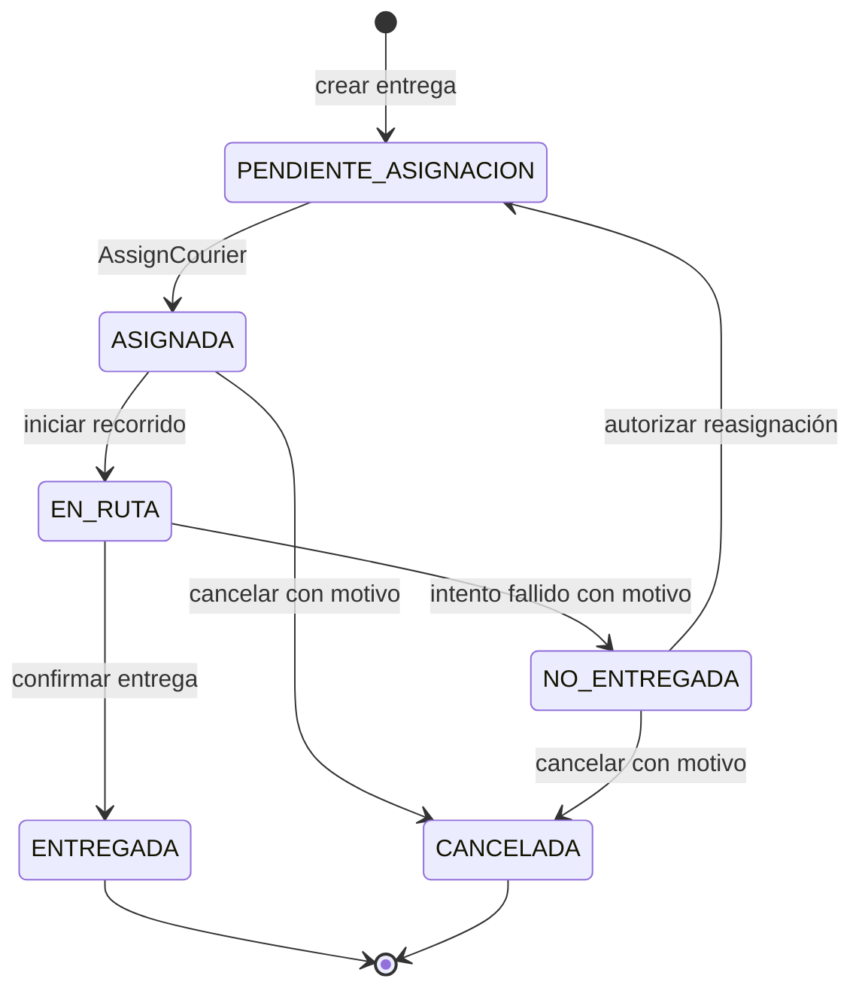
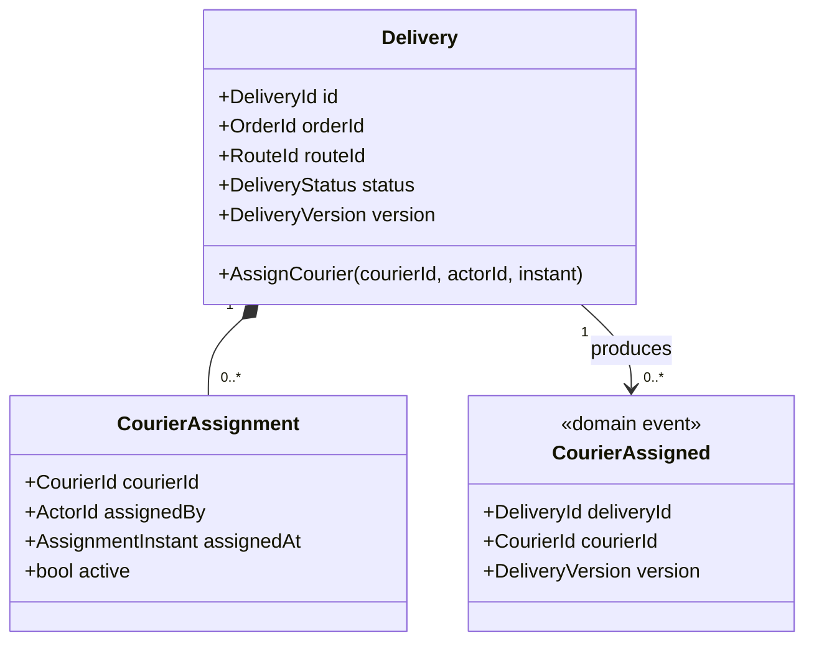

# Modelo de dominio

## Agregado Entrega

`Entrega` (`Delivery`) es la raíz del agregado del flujo. Toda asignación debe realizarse mediante `AssignCourier`; ningún caso de uso ni adaptador puede modificar directamente el repartidor activo.

| Elemento | Clasificación | Responsabilidad |
| --- | --- | --- |
| Entrega (`Delivery`) | Entidad y raíz de agregado | Proteger estado, ruta, repartidor activo, versión e invariantes. |
| AsignaciónRepartidor | Entidad interna | Conservar repartidor, inicio, autor y eventual cierre de una asignación. |
| Pedido | Entidad de otro contexto | Ser propietario de la información comercial; se referencia por `PedidoId`. |
| Incidencia | Entidad de otro contexto | Registrar excepciones sin modificar directamente la entrega. |
| `DeliveryId`, `OrderId`, `RouteId`, `CourierId`, `ActorId` | Objetos de valor | Identificadores tipados, inmutables y no vacíos. |
| `DeliveryStatus` | Objeto de valor enumerado | Expresar un estado permitido. |
| `AssignmentInstant` | Objeto de valor | Fecha y hora inequívocas de la asignación. |
| `DeliveryVersion` | Objeto de valor | Número monotónico para detectar concurrencia. |
| `Reason` | Objeto de valor | Justificación codificada y descrita cuando una regla la exige. |

## Estados y transiciones propuestos

Solo `PENDIENTE_ASIGNACION` a `ASIGNADA` forma parte del caso obligatorio. Las demás transiciones permiten ubicarlo dentro de RF-005 y deben validarse.

## Invariantes

| ID | Regla | Responsable |
| --- | --- | --- |
| INV-01 | Una entrega tiene una identidad y un pedido asociado que no cambian. | Constructor de Entrega. |
| INV-02 | Una entrega no puede tener más de un repartidor activo. | `Delivery.AssignCourier`. |
| INV-03 | Solo una entrega en `PENDIENTE_ASIGNACION` puede recibir la asignación inicial. | `Delivery.AssignCourier`. |
| INV-04 | El `CourierId` asignado no puede ser vacío. | Objeto de valor y entidad. |
| INV-05 | Un repartidor debe estar disponible al momento de la asignación. | Caso de uso mediante `ICourierAvailability`. |
| INV-06 | Si se aplica la regla de capacidad, la ruta no puede estar saturada. | Caso de uso mediante `IRouteCapacity`. |
| INV-07 | La asignación aceptada incrementa una vez la versión y produce `CourierAssigned`. | Agregado y unidad de persistencia. |
| INV-08 | Un comando con versión obsoleta no sobrescribe un cambio confirmado. | `IDeliveryRepository` con concurrencia optimista. |
| INV-09 | Repetir la misma solicitud no duplica la asignación ni el evento. | Límite de aplicación mediante `requestId`. |
| INV-10 | Los adaptadores no pueden omitir la entidad ni escribir directamente sus datos. | Arquitectura y pruebas de dependencias. |

INV-05 e INV-06 dependen de información externa al agregado. Se validan antes de invocar el método de dominio, pero la entidad conserva INV-02 a INV-04 aunque otro componente falle.

## Comportamiento de la entidad

`AssignCourier(courierId, actorId, instant)`:

1. rechaza un identificador vacío;
2. rechaza si ya existe una asignación activa;
3. rechaza si el estado no es `PENDIENTE_ASIGNACION`;
4. crea la asignación, cambia a `ASIGNADA` e incrementa la versión;
5. registra `CourierAssigned` con entrega, pedido, ruta, repartidor, actor, instante y versión.

## Eventos

| Evento | Uso |
| --- | --- |
| `CourierAssigned` | Trazabilidad, proyección de consulta y posible notificación posterior. |
| `DeliveryStatusChanged` | Seguimiento del ciclo de entrega. |
| `CourierAssignmentRejected` | No es un evento del agregado: puede ser un registro de aplicación porque no ocurrió un cambio de negocio. |

## Diagrama del agregado

