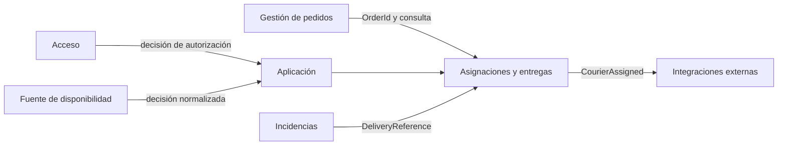
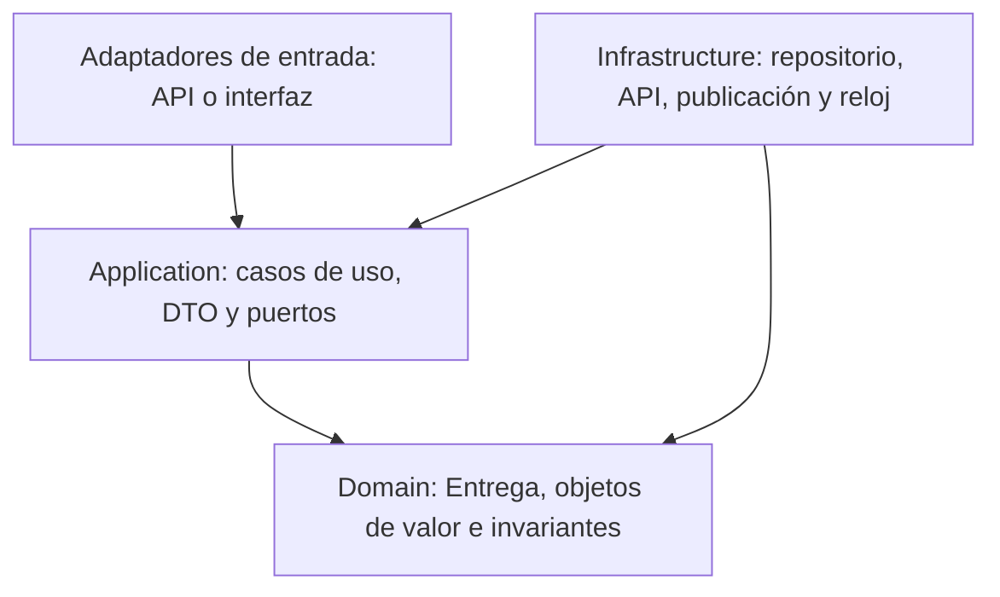

# Contextos, capas, puertos y adaptadores

## Contextos delimitados

| Contexto | Propiedad | Relación con el flujo |
| --- | --- | --- |
| Gestión de pedidos | Pedido, canal y estado comercial. | Proporciona la referencia del pedido; no asigna repartidores. |
| Asignaciones y entregas | Entrega, asignación activa, estado y eventos. | Contexto principal y propietario del agregado. |
| Incidencias | Incidencia, tipo, resolución y responsable. | Referencia la entrega por contrato. |
| Acceso | Identidad, roles y políticas. | Decide si el actor puede ejecutar el caso. |
| Integraciones externas | Traducción y fallos de proveedores confirmados. | Implementa adaptadores de disponibilidad o notificación. |

## Mapa de contextos



Las flechas representan contratos; ningún contexto accede a las tablas de otro. La fuente de disponibilidad puede resultar interna o externa y debe validarse.

## Separación por capas



La dirección de dependencia apunta hacia adentro:

- **Dominio:** no depende de Aplicación ni Infraestructura.
- **Aplicación:** depende del Dominio y define los puertos necesarios.
- **Infraestructura:** implementa puertos y puede depender de las capas interiores.

## Puertos y adaptadores propuestos

| Puerto | Adaptador posible | Estado |
| --- | --- | --- |
| `IAssignCourier` | Controlador HTTP o interfaz de operador | Propuesto, sin tecnología elegida. |
| `IDeliveryRepository` | Repositorio para la persistencia de LogiTrack | Pendiente de Actividad 4. |
| `ICourierAvailability` | Adaptador a catálogo interno o API logística | Fuente pendiente de validar. |
| `IRouteCapacity` | Adaptador a consulta de rutas | Regla y fuente pendientes. |
| `IAuthorizationService` | Adaptador a política común de Acceso | Matriz de permisos pendiente. |
| `IDomainEventPublisher` | Adaptador de publicación fiable | Mecanismo pendiente de Actividad 4. |
| `IIdempotencyStore` | Adaptador de almacenamiento de solicitudes | Mecanismo pendiente. |
| `IClock` | Reloj del sistema y reloj controlado para pruebas | Propuesto. |

## Dependencias permitidas

- Las entidades y objetos de valor no importan frameworks, almacenamiento ni clientes HTTP.
- Los casos de uso reciben puertos por constructor.
- Los adaptadores pueden depender de puertos y DTO, nunca al revés.
- Un módulo no escribe datos que pertenecen a otro.
- La vista central compone contratos de consulta; no comparte entidades persistentes.
- Las dependencias entre módulos deben conservarse dirigidas y sin ciclos.

## Estructura futura recomendada

La guía propone una organización conceptual que podrá materializarse en la Actividad 4:

```text
src/
  Domain/          entidades, objetos de valor, eventos e invariantes
  Application/     casos de uso, DTO, contratos y puertos
  Infrastructure/  repositorios, APIs, publicación y adaptadores
tests/              pruebas de dominio e integración del flujo
```

Esta estructura no obliga a utilizar una tecnología específica.

