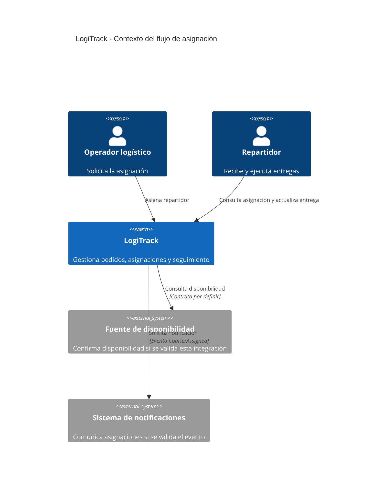
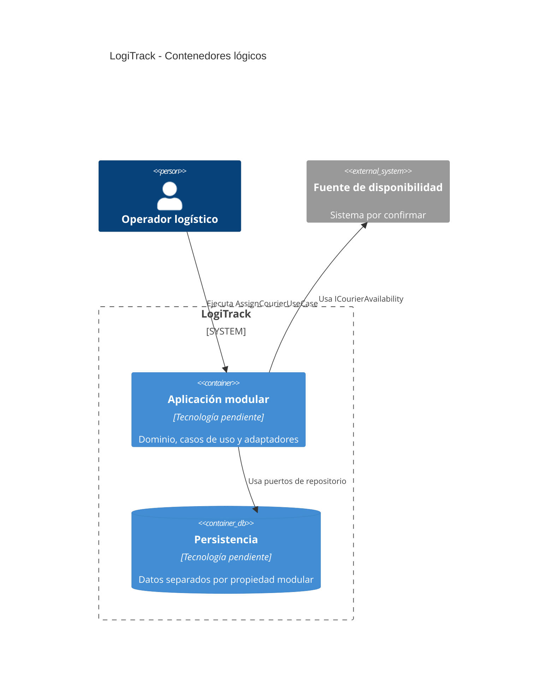
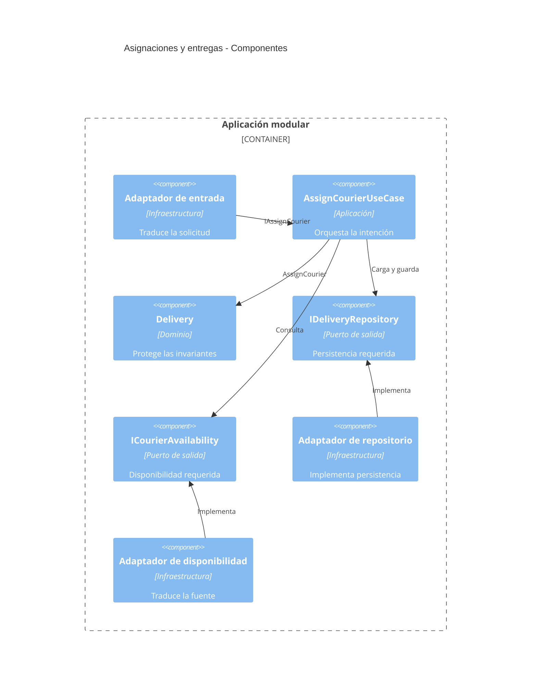
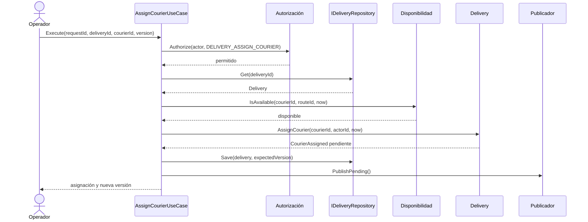

# Diagramas C4 actualizados

## Nivel 1 — Contexto

## Nivel 2 — Contenedores

El contenedor Aplicación modular es una sola unidad de despliegue, coherente con ADR-001; los módulos no son microservicios.

## Nivel 3 — Componentes del flujo

## Secuencia principal

## Coherencia entre diagramas

El contexto conserva los sistemas externos fuera de LogiTrack; el nivel de contenedores conserva el monolito modular; el nivel de componentes muestra la inversión de dependencias; y la secuencia utiliza los mismos nombres y contratos definidos en el modelo y los casos de uso.

