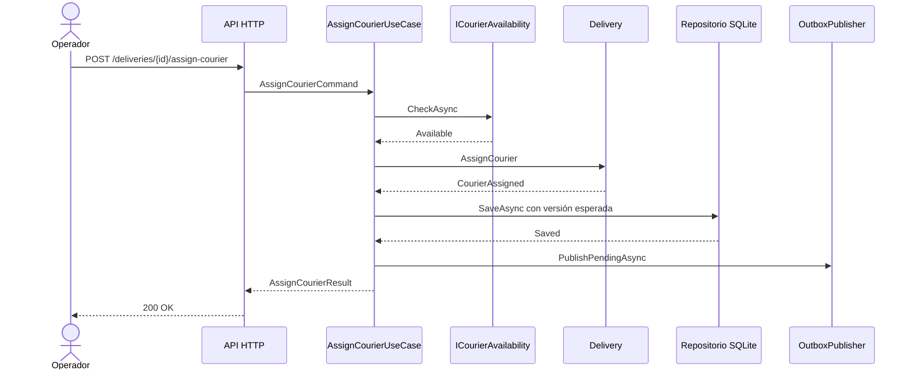

# Alcance del vertical slice y trazabilidad

## Objetivo implementado

La Actividad 4 implementa el flujo diseñado en la Actividad 3: **asignar un repartidor disponible a una entrega existente**. La solución cubre el recorrido ejecutable desde HTTP hasta SQLite y conserva `Delivery` como centro del negocio.

## Recorrido funcional

## Trazabilidad con la Actividad 3

| Diseño previo | Implementación | Verificación |
| --- | --- | --- |
| `Delivery` como agregado | `src/LogiTrack.Domain/Delivery.cs` | `DeliveryTests` |
| Identificadores como objetos de valor | `DeliveryIds.cs` | Pruebas de dominio y compilación tipada |
| `CourierAssigned` | `DeliveryEvents.cs` y tabla `outbox_events` | Prueba unitaria e integración exitosa |
| `AssignCourierUseCase` | `src/LogiTrack.Application/AssignCourierUseCase.cs` | Siete pruebas de aplicación |
| `IDeliveryRepository` | Puerto en Aplicación y adaptador SQLite | Prueba HTTP–SQLite |
| `ICourierAvailability` | Adaptador configurable | Pruebas 422 y 503 |
| Autorización | `IAuthorizationService`, rol y clave API en entrada | Pruebas 401 y de rol |
| Idempotencia | `IIdempotencyStore` y tabla propia | Prueba de solicitud repetida |
| Concurrencia optimista | `expectedVersion` y `UPDATE ... WHERE version` | Pruebas de conflicto |
| Dependencias hacia adentro | Cuatro proyectos separados | Dos fitness functions |

## Dentro del alcance

- creación automática del esquema mediante una migración SQL versionada;
- dato de entrega demostrativo solo en ambiente Development;
- asignación, consulta posterior y publicación del resultado;
- manejo controlado de autenticación, autorización, datos inválidos, no disponibilidad, conflictos y errores técnicos;
- logs estructurados, correlación, `ActivitySource` y métricas con `Meter`;
- pruebas de dominio, aplicación, integración y arquitectura.

## Fuera del alcance

- administrar pedidos, rutas o repartidores completos;
- optimizar rutas;
- autenticar usuarios con un proveedor de identidad real;
- utilizar un broker distribuido;
- desplegar infraestructura productiva;
- implementar los demás estados de la entrega.

